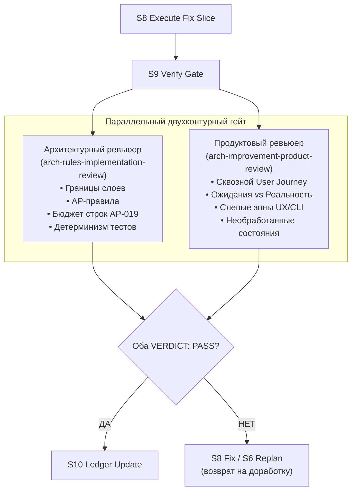

# Arch Improvement Skills

Навыки для агентов, которые запускают архитектурно-осмысленный цикл улучшения репозитория: review -> plan -> fix -> verify -> learn.

Это не “ещё один code review prompt”. Это state machine поверх Superpowers и arch-rules, чтобы агент не просто нашёл проблемы, а разумно выбрал, что чинить, что только логировать, что блокировать, и как не потерять уроки между циклами.

## Зачем Это Нужно

Когда проект развивается через агентов, легко получить странное состояние:

- код вроде работает;
- тесты иногда зелёные;
- агент уверенно говорит, что всё нормально;
- но непонятно, где архитектурные границы, какие риски остались и почему конкретные правки были сделаны.

`arch-improvement-skills` закрывает работу:

> Я хочу дать агенту репозиторий и попросить его улучшать код не хаотично, а по циклу: сначала понять контекст и правила, потом найти реальные проблемы, потом спланировать bounded fixes, потом починить только разумное, всё проверить и записать, что осталось.

Цель не в том, чтобы агент “причесал” весь проект. Цель в том, чтобы он двигался маленькими проверяемыми циклами и не превращал review в вкусовщину или бесконечный рефакторинг.

## Что Внутри

Пакет намеренно разбит на маленькие skills:

- `arch-improvement-loop` - тонкий orchestrator/state machine цикла.
- `arch-improvement-memory` - project-local память повторяющихся уроков.
- `arch-improvement-orientation` - поиск настоящего repo root, source of truth, active paths и test surface.
- `arch-improvement-review` - severity-ranked review с разделением `fix-now`, `log-only`, `blocked`.
- `arch-improvement-fix` - bounded repair через TDD и architecture gates.
- `arch-improvement-product-review` - независимое продуктовое ревью пользовательского сценария, ожиданий vs реальности и полноты UX/CLI состояний.
- `arch-improvement-ledger` - markdown-журнал findings, решений, правок, verification и residual risk.

Важный принцип: `arch-improvement-loop` не должен становиться god-skill. Он только управляет переходами state machine. Работу делают узкие skills.

## Что Считается Успешным Циклом

Хороший цикл даёт не “я посмотрел, стало лучше”, а набор проверяемых артефактов:

- найденный source of truth проекта;
- `Architecture Context Map`;
- список findings с severity;
- triage: `fix-now`, `log-only`, `blocked`;
- сохранённый Superpowers plan;
- red/green или другой честный verification для каждой правки;
- ledger section;
- memory update, если цикл нашёл повторяемый урок.

Если чего-то из этого нет, агент не должен заявлять, что цикл завершён.

## State Machine

Цикл работает как state machine:

| State | Смысл |
| --- | --- |
| S0 Bootstrap | repo root, branch, dirty worktree, local instructions |
| S1 Memory Load | прочитать project-local memory |
| S2 Orientation | найти source of truth и собрать Architecture Context Map |
| S3 Brainstorm | согласовать и подтвердить дизайн с пользователем (hard-gate) |
| S4 Review | найти реальные defects и risks |
| S5 Triage Gate | решить `fix-now`, `log-only`, `blocked` |
| S6 Plan Write | сохранить Superpowers plan |
| S7 Plan Review | критически проверить план до исполнения |
| S8 Execute Fix Slice | чинить только planned slices |
| S9 Verify Gate | свежая verification evidence (двухконтурный гейт: арх + продукт) |
| S10 Ledger Update | записать полный markdown trace |
| S11 Learn Gate | обновить memory или явно сказать `no durable lesson` |
| S12 Stop | короткий финальный отчёт |

### Двухконтурный Гейт Верификации (S9 Verify Gate)

В состоянии **S9 Verify Gate** оркестратор запускает двух параллельных независимых сабагентов:

1. **Архитектурный ревьюер** (`arch-rules-implementation-review`):
   - проверка архитектурных границ и композиционных корней;
   - соответствие baseline AP-правилам;
   - соблюдение бюджетов строк (AP-019);
   - детерминизм и изоляция тестов.
2. **Продуктовый ревьюер** (`arch-improvement-product-review`):
   - сквозная трассировка пользовательского сценария (User Journey): ввод → реакция → результат → ошибки;
   - сопоставление ожиданий пользователя/оператора с фактическим поведением;
   - проверка слепых зон: отсутствие «тихих проглатываний» ошибок, полнота UX/CLI-обратной связи;
   - закрытие всех состояний: пустые данные, отмена (Ctrl-C), фоновый режим, ошибки.

```text
                  ┌──────────────────────┐
                  │ S8 Execute Fix Slice │
                  └──────────┬───────────┘
                             │
                             ▼
                  ┌──────────────────────┐
                  │    S9 Verify Gate    │
                  └──────────┬───────────┘
                             │ (параллельный запуск)
               ┌─────────────┴─────────────┐
               ▼                           ▼
    ┌──────────────────────┐    ┌──────────────────────┐
    │     Архитектура      │    │       Продукт        │
    │  arch-rules-impl-    │    │   arch-improvement-  │
    │       review         │    │   product-review     │
    │                      │    │                      │
    │ • границы слоёв      │    │ • сквозной сценарий  │
    │ • AP-правила         │    │ • ожидания vs факт   │
    │ • бюджет строк       │    │ • blind spots UX/CLI │
    │ • детерминизм тестов │    │ • unhandled states   │
    └──────────┬───────────┘    └──────────┬───────────┘
               │                           │
               └─────────────┬─────────────┘
                             ▼
                    Оба VERDICT: PASS?
                            / \
                       ДА  /   \  НЕТ (FAIL)
                          /     \
                         ▼       ▼
              ┌─────────────┐   ┌──────────────────────┐
              │ S10 Ledger  │   │ S8 Fix / S6 Replan   │
              │   Update    │   │ (возврат на доработку│
              └─────────────┘   │  или triage/blocked) │
                                └──────────────────────┘
```



Гейт **S9** считается пройденным только тогда, когда **ОБА** ревьюера выдают `VERDICT: PASS`. Любые открытые замечания **P0, P1 или P2** дают `VERDICT: FAIL` и блокируют переход в S10 до их исправления. Только замечания P3 (стиль, косметика) могут быть залогированы как `log-only` без провала гейта.

Жёсткие правила:

- никаких code edits до сохранённого Superpowers plan;
- никакого plan без memory, orientation и Architecture Context Map;
- никаких fix вне плана, кроме минимального unblock verification, и это логируется;
- никакого перехода между состояниями без обязательного артефакта.

## Зависимости

Пакет не standalone.

Нужно установить:

1. [Superpowers](https://github.com/obra/superpowers)
2. [arch-rules-skills](https://github.com/VanDalkvist/arch-rules-skills)
3. этот repo: [arch-improvement-skills](https://github.com/VanDalkvist/arch-improvement-skills)

Также нужен readable architecture baseline:

- preferred: project-pinned rules в целевом проекте;
- fallback: [ai-meatbags/arch-rules](https://github.com/ai-meatbags/arch-rules).

Минимальная поверхность Superpowers:

- `superpowers:using-superpowers`
- `superpowers:brainstorming`
- `superpowers:writing-plans`
- `superpowers:executing-plans`
- `superpowers:test-driven-development`
- `superpowers:verification-before-completion`

Минимальная поверхность arch-rules & review:

- `arch-rules-context`
- `arch-rules-slice-planning`
- `arch-rules-implementation-review`
- `arch-improvement-product-review`

## Bootstrap Для Агента

Если агенту дали только ссылку на этот repo, он должен сделать так:

1. Проверить, что Superpowers установлен.
2. Установить или проверить `arch-rules-skills`.
3. Найти readable architecture baseline:
   - project-pinned rules;
   - явно указанный baseline URL;
   - иначе [ai-meatbags/arch-rules](https://github.com/ai-meatbags/arch-rules).
4. Установить все `arch-improvement-*` skills.
5. Перед запуском loop вызвать `arch-rules-context` и получить `Architecture Context Map`.
6. Только потом запускать `arch-improvement-loop`.

Fail-fast форма:

```text
Cannot start arch-improvement-loop.
Missing: <Superpowers skill | arch-rules skill | readable architecture-rules baseline>
Tried: <paths and URLs checked>
Next action: <install dependency or provide baseline URL/path>
```

Нельзя деградировать в обычный review checklist, если не найден baseline или не установлены зависимости.

## Что Чинить, А Что Только Логировать

Чинить:

- P0/P1/P2 defects с реальным impact;
- broken contracts;
- security/privacy/secret issues;
- architecture boundary violations;
- runtime/config validation failures;
- missing tests вокруг выбранной правки.

Только логировать:

- стиль;
- вкусовые переименования;
- широкие рефакторы без понятного эффекта;
- “было бы красиво”;
- speculative design;
- unrelated failures, если они не блокируют verification текущего slice.

Блокировать:

- destructive changes;
- внешне видимые действия;
- credential/secret/data migration изменения;
- product или architecture decisions, требующие согласования.

## Установка В Codex

Инструкция для агента:

```text
First ensure Superpowers is installed and that these skills are available: superpowers:using-superpowers, superpowers:writing-plans, superpowers:executing-plans, superpowers:test-driven-development, superpowers:verification-before-completion.
Then install arch-rules-skills from https://github.com/VanDalkvist/arch-rules-skills.
Before running arch-improvement-loop, resolve a readable architecture-rules baseline. Prefer project-pinned rules; otherwise use https://github.com/ai-meatbags/arch-rules.
Install all skills from https://github.com/VanDalkvist/arch-improvement-skills/tree/main/skills into Codex.
Use the Codex skill-installer flow if available. Install every arch-improvement-* skill, not only arch-improvement-loop.
Fail fast if Superpowers, arch-rules-skills, or a readable baseline is missing.
After installation, restart Codex so the skills are discovered.
```

Manual fallback:

```sh
git clone https://github.com/VanDalkvist/arch-improvement-skills.git
cd arch-improvement-skills
mkdir -p "${CODEX_HOME:-$HOME/.codex}/skills"
cp -R skills/arch-improvement-* "${CODEX_HOME:-$HOME/.codex}/skills/"
```

## Установка В Claude Code

Сначала установи Superpowers plugin или подтверди эквивалентные Superpowers skills: https://claude.com/plugins/superpowers

Personal install:

```sh
git clone https://github.com/VanDalkvist/arch-improvement-skills.git
cd arch-improvement-skills
mkdir -p "$HOME/.claude/skills"
cp -R skills/arch-improvement-* "$HOME/.claude/skills/"
```

Project install:

```sh
git clone https://github.com/VanDalkvist/arch-improvement-skills.git
cd your-project
mkdir -p .claude/skills
cp -R ../arch-improvement-skills/skills/arch-improvement-* .claude/skills/
```

Claude Code skills documentation: https://code.claude.com/docs/en/skills

## Project Artifacts

По умолчанию skills пишут project-local артефакты:

- memory: `docs/arch-improvement/memory.md` или `.arch-improvement/memory.md`
- ledger: `docs/arch-improvement/review-log.md` или `.arch-improvement/review-log.md`
- plans: `docs/superpowers/plans/YYYY-MM-DD-arch-improvement-cycle-N.md`, если local instructions не говорят иначе

Эти файлы нужны, чтобы следующий цикл не начинался с нуля.

## Проверка

```sh
find skills -name SKILL.md -maxdepth 3 -print
grep -R "<project-specific-name>\|<absolute-home-path>\|<private-user-name>" -n skills docs README.md AGENTS.md scripts || true
```

Для Codex schema validation:

```sh
for skill in skills/arch-improvement-*; do
  uv run --with pyyaml python "$HOME/.codex/skills/.system/skill-creator/scripts/quick_validate.py" "$skill"
done
```

## License

MIT.
